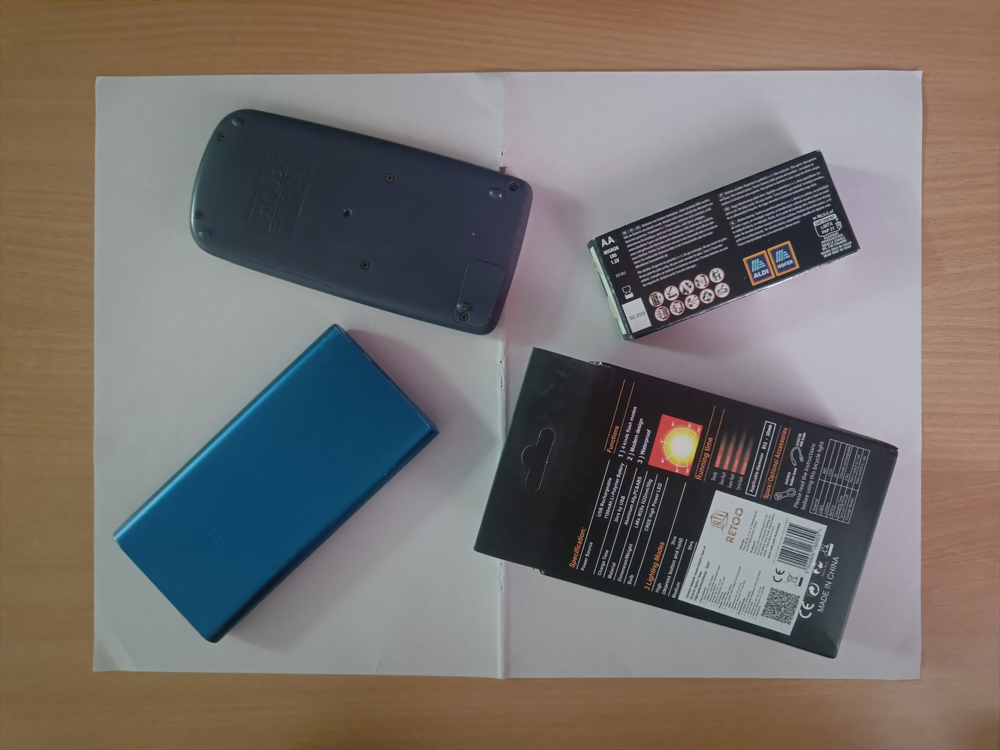
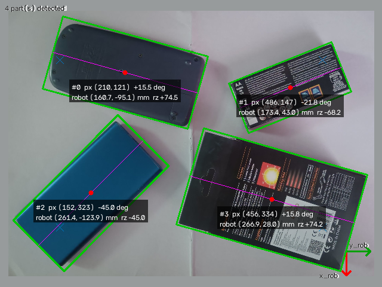
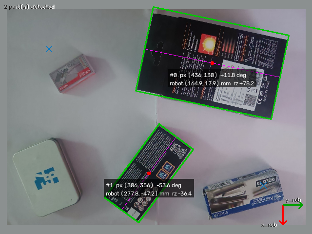
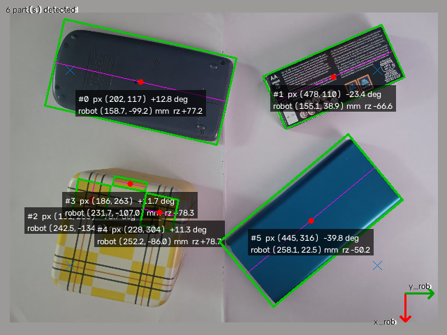
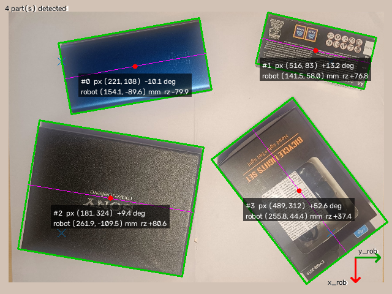
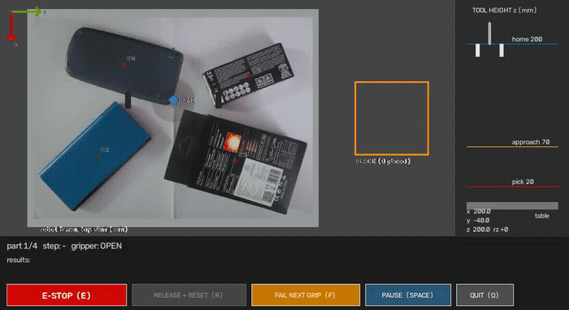

# Pick and place with a camera

This program finds rectangular parts in a camera image taken from above,
converts their positions to robot coordinates, and runs a pick and place cycle.
There is no real robot. I wrote a fake robot so everything can be tested on a
laptop.

```
camera.py -> vision.py -> calibration.py -> cycle.py (uses robot.py)
 get image    find parts   pixel to robot     pick and place
```

## Setup

You need Python 3.10 or newer.

```bash
python -m venv .venv
source .venv/bin/activate          # Windows: .venv\Scripts\activate
pip install -r requirements.txt
```

## How to run

```bash
# run on my test photo
python -m pickplace.main --image data/test_photo.jpg --paper

# use the webcam; if it fails, the program uses the photo
python -m pickplace.main --camera 0 --image data/test_photo.jpg --paper

# make the first part fail 3 times to see the retry and the alarm
python -m pickplace.main --image data/test_photo.jpg --paper --grip-fail 3
```

The program prints a table and saves these files in `results/`:

- `annotated.png`: the image with boxes, centers, angles and robot coordinates
- `input_640x480.png`: the image that the detection used
- `result.json`: the poses and the cycle results

## Tests

```bash
pytest
```

There are 95 tests and they need no hardware.

The tests cover:

- calibration: the 4 given points, points in between, angles, wrong input
- detection: center and angle on generated images where the true values are known
- camera: retry, recovery, fallback to a file, missing and broken files
- cycle: success, failed grip, skip with alarm, e-stop at every step, timeout
- simulator and paper crop

## Test photo and result

| My photo (`data/test_photo.jpg`) | Result (`results/annotated.png`) |
|---|---|
|  |  |

I used four objects on A4 paper: a calculator, a battery box, a power bank and
a bicycle light box. This is the output:

```
 #       u       v  ang_img |    x_mm    y_mm      rz | pick z | appr z
 0   209.9   121.4     15.5 |   160.7   -95.1    74.5 |     20 |     70
 1   486.0   146.8    -21.8 |   173.4    43.0   -68.2 |     20 |     70
 2   152.2   322.8    -45.0 |   261.4  -123.9   -45.0 |     20 |     70
 3   455.9   333.9     15.8 |   266.9    28.0    74.2 |     20 |     70
```

I checked the result in two more ways:

- I took a second photo of the same scene by hand
  (`data/repeatability/shot_a.jpg`). All centers are within about 2 px (1 mm) and
  all angles within 0.3 degrees of the first photo.
- I took a photo of other objects in different light
  (`data/second_scene.jpg`). All 4 objects are found. The result is in
  `results/second_scene/annotated.png`.

### Why the `--paper` option

In the assignment the camera is fixed above the table and its 640x480 image is
the work area. My photo is taken by hand with a phone, so it also shows the
desk, it is a little tilted, and it has another size. The `--paper` option
finds the white sheet, makes it straight, and fits it into 640x480. With a
fixed camera this step is not needed.

### What did not work

I took about 15 photos and some of them failed. Three examples are in
`data/failed/`, with the results in `results/failed/`:

| White objects | Object with a pattern | Hard shadow |
|---|---|---|
|  |  |  |
| Only 2 of 5 parts are found. | The yellow tin is split into small parts. | The box at the bottom left is too big. |

- White or light grey objects are not found, because the program looks for
  parts that are darker or more colourful than the paper.
- An object with a white pattern (a yellow checked tin) is split into several
  small parts. This is the worst case, because the robot would grip at wrong
  places.
- Hard shadows from a desk lamp or the sun are counted as part of a dark box.
  The box becomes too big and the center moves by some millimetres.
- A blurry photo gave extra wrong parts.

## Main design decisions

**Detection.** I use classical image processing, not deep learning. I assumed
the parts are darker or more colourful than the paper, so a threshold and
contours are enough. It needs no training data and it is easy to test. Each pixel gets
a score from its colour strength and darkness, and the Otsu method picks the
threshold, so I do not need a fixed number for the lighting. I reject a shape
if it is too small, too big, touches the image border, or is not a rectangle.
I think it is better to skip a part than to grip it wrong. The angle is the
direction of the long side, between -90 and +90 degrees.

**Pixel to robot.** From the four points I found that 1 pixel is 0.5 mm and
that the axes are swapped: right in the image is robot +y, and down in the
image is robot +x. The formulas are `x = 150 + 0.5 * (v - 100)` and
`y = -150 + 0.5 * (u - 100)`. In the code I calculate a homography from the
four points instead of typing the formulas, so it also works if the camera is
a little tilted. The tests compare both. Because the axes are swapped, I also
convert the angle to the robot frame. The pick pose is at z = 20 mm and the
approach pose is at z = 70 mm, with the same x, y and angle.

**Robot interface.** The interface has only what the cycle needs: joint move,
linear move, stop, open and close gripper, gripper feedback, read input,
e-stop state and alarm. The robot goes to the approach pose with a fast joint
move. The last 50 mm down to the part and back up are slow linear moves, so
the gripper does not push the part away. The fake robot saves every command,
so the tests can check the exact order. It can also simulate a failed grip, an
e-stop, or a dropped part.

**Cycle and safety.**

- Every command goes through one function that checks the e-stop before and
  after the command. On e-stop the cycle stops the robot, raises an alarm, and
  sends no more commands. The tests press the e-stop at each of the 10 steps.
- After an e-stop the cycle stays locked. It runs again only after the e-stop
  is released and the operator calls `reset()`. Then the robot first goes home
  slowly.
- A failed grip is tried again 2 times. After 3 failed grips the robot goes
  home, raises an alarm, and continues with the next part.
- The cycle also handles: no part arrives in time, the part is lost on the
  way, a pose is outside the work area, and other robot errors.

## Part 4: Written questions

**1. Define edge cases and error handling methods that you would like to
integrate, and how?**
While testing with my photos I found shadows, white parts, patterned parts and
blurry images, and I also handle parts cut by the image border and parts
touching each other. My rule is: if the program is not sure about a shape, it
skips it, because a wrong grip is worse than a missed part. For the camera I
retry a few times with a clear error, and in the cycle a failed grip is
retried, a lost part or a pose outside the work area raises an alarm, and an
e-stop stops and locks the cycle. Next I would add a sharpness check for
blurry frames and a check that the gripper fingers have space next to the part.

**2. A robot consistently picks 2 mm away from the target. Where do you look
first?**
A constant error is a wrong offset somewhere, not noise. First I would send
the robot to a known point without the camera: if it reaches the point, the
error is in the camera calibration, if not, it is in the robot or the tool.
If the 2 mm error turns with the gripper angle, the TCP (tool center point) is
wrong, and if it stays the same in the robot frame, the camera to robot
calibration or the base frame is wrong. I would also check that the camera or
the calibration sheet has not moved since the calibration.

**3. What should the software do when an emergency stop is released?**
Nothing should move when the e-stop is released. Releasing it only allows a
reset, and after the reset the operator still has to start the robot again. Then
I would check the state first, for example if the gripper is still holding a
part, and move home slowly without opening the gripper. In my code the cycle
stays locked until `reset()` is called, and the first move after it is a slow
move home.

## Extra: simulator



This is not asked in the assignment. I added it to see the cycle working. It
runs the same cycle code as the tests and shows the table from above in robot
coordinates.

```bash
python -m pickplace.simulator --image data/test_photo.jpg --paper          # with buttons
python -m pickplace.simulator --image data/test_photo.jpg --paper --demo   # automatic demo
```

Buttons: E-STOP (key E), RELEASE + RESET (R), FAIL NEXT GRIP (F), PAUSE
(Space), QUIT (Q). The e-stop button stops the robot in the middle of a move.
On a real robot the e-stop is a hardware circuit. This button only simulates
the signal.

## Files

| File | What it does |
|---|---|
| `pickplace/camera.py` | reads a frame from the webcam or a file, with retries |
| `pickplace/vision.py` | finds the parts and draws the result image |
| `pickplace/paper.py` | crops a hand photo to the white paper |
| `pickplace/calibration.py` | pixel to robot coordinates, pick and approach poses |
| `pickplace/robot.py` | robot interface and fake robot |
| `pickplace/cycle.py` | pick and place cycle |
| `pickplace/main.py` | runs everything from the command line |
| `pickplace/simulator.py` | simulator window |
| `pickplace/synthetic.py` | generated test images |

## What I would do next

- Find white and patterned parts by their outline instead of their colour.
- Use soft, even light to avoid hard shadows.
- Check the image sharpness before detection.
- Calibrate with more than 4 points and correct the lens distortion.
- Check the grip with the finger width, not only with one signal.
